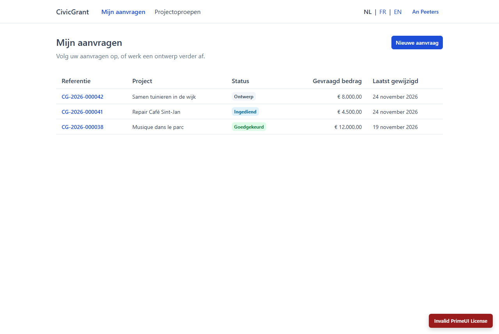
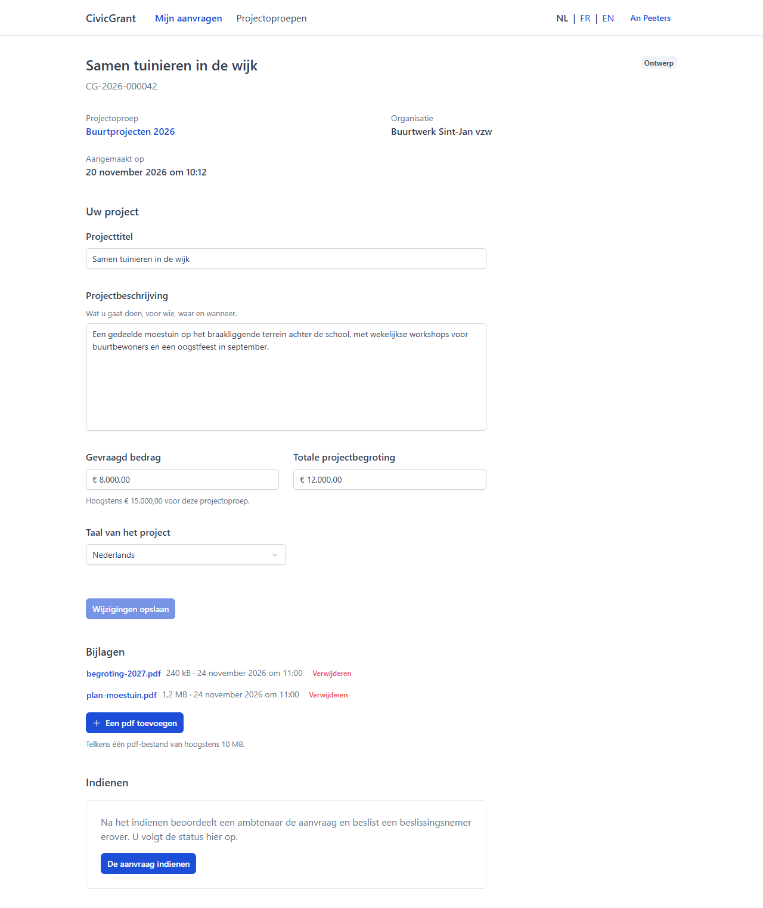
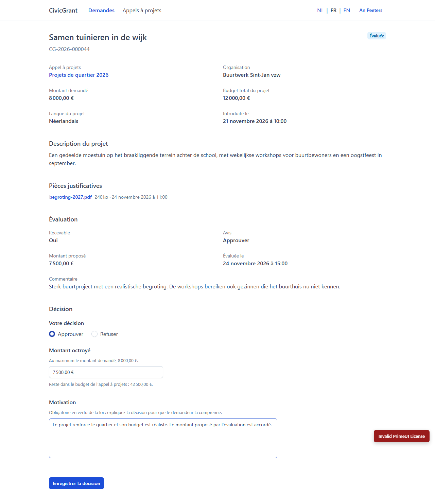
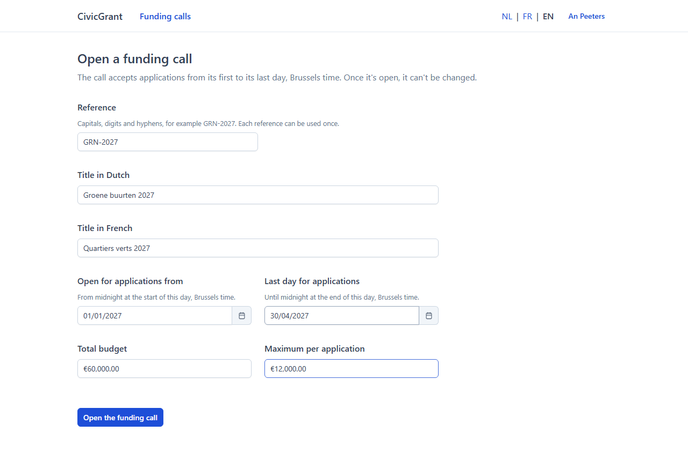

# CivicGrant frontend

[](https://github.com/AchZak/civicgrant-frontend/actions/workflows/ci.yaml?query=branch%3Adevelop)

The Angular app of CivicGrant, a grant application portal for a (fictional) Belgian public administration. Non-profits apply to a funding call, a civil servant assesses each application, and a separate decision maker approves or rejects it with a written motivation. The domain, the rules and the decisions behind them are described in the [backend's README](https://github.com/AchZak/civicgrant-backend).

The app is in Dutch, French and English, and it's a thin presentation layer: the backend enforces every business rule and access rule, and the app shows what the API answers.

## Screens

An applicant's applications, and a draft with its documents, ready to submit:





A decision maker approving an assessed application, in French, and a programme manager opening a funding call, in English:





The screenshots come from the app running against a mocked API, the same way the journeys run. The red banner is PrimeNG's: it shows until a PrimeUI licence key is configured.

## Status

- [x] Scaffold: the shell, PrimeNG and Tailwind, types generated from the API contract, CI
- [x] Three languages, switched at runtime
- [x] Sign-in with Microsoft Entra ID (the app's side; its Entra registration isn't deployed yet)
- [x] Navigation and start page per role
- [x] Applicant flow: funding calls, organisations, drafts, documents and submission
- [x] Assessment and decision
- [x] Opening a funding call
- [x] Deployment to Azure Static Web Apps (test environment)

## How it's built

Angular 22 with standalone components, signals and no zone.js. PrimeNG provides every widget and the look, through one theme preset; Tailwind is only used for layout.

The API contract in the backend repository is the single source of truth. `npm run api:types` generates the TypeScript types from a tagged version of it, read from GitHub, so the app never declares an API shape by hand and always says which contract it was built against. The generated file is committed, CI fails when it doesn't match that tag, and Renovate opens a pull request when the backend tags a new contract. `npm run api:types:local` reads the backend checked out next to this repository instead, for a change that touches both. Pages read through `httpResource`, and each feature has one file that knows its URLs. Writes go through a small service per feature and return promises, so components never subscribe to anything.

The API answers with codes, never with text. Statuses, legal forms, rejection grounds and problem types are translated in the app, one list per kind, and an unknown code falls back to a generic message, so a new code in the backend never breaks a page. When the backend refuses a form, the problem's input issues and field-specific codes appear next to the field concerned, and everything else above the form. A change made by someone else at the same time gives a 409, and the page offers to reload.

Forms use Angular's Signal Forms with PrimeNG's inputs. The only rules checked in the browser are the ones the contract states (required fields, maximum lengths, the funding call's maximum amount, an amount only when approving), so the user sees them early; the backend still decides.

Staff work from the same application page as applicants. An assessor gets the assessment form while an application is submitted, and a decision maker the decision form once it's assessed, with the assessor's proposed amount filled in and a confirmation first, since a decision is final. The page can't know who assessed an application, so a decision maker who did sees the form and the backend's refusal above it. Staff can filter the list by status, and the filter stays in the address bar.

A programme manager opens funding calls: a reference, a title in Dutch and French, the first and last day for applications, the budget and the maximum per application. The API wants moments in UTC, so the app turns the chosen days into midnight in Brussels, at the start of the first day and at the end of the last, whatever time zone the browser is in. Summer time makes that easy to get wrong, so it has a unit test of its own.

The texts come from Transloco, in one JSON file per language with English as the reference. The switch in the header changes the language without a reload and remembers it; a first visit gets the browser's language if it's one of the three, else Dutch. Templates and code only hold keys, grouped by feature and then by screen, so the same field label is one key wherever it shows up. Each file is imported rather than fetched, so the build gives it a hashed name and a browser never keeps an old version after a deploy. Money, dates and PrimeNG's own texts follow the language too. A funding call's title only exists in Dutch and French, so the English pages show the Dutch one, marked as Dutch for screen readers.

Nothing in the build fails on a missing translation, so two checks stand in: a unit test that the three files have the same keys, and the journeys fail when a screen they visit asks for a key that doesn't exist.

Sign-in uses Microsoft Entra ID with MSAL, before Angular starts: the app either runs with a signed-in user or redirects to sign in. An interceptor adds the access token to API calls only. The user's roles come from the API's `/me`, read once at startup: each role gets its own start page and navigation, and a page outside the user's roles says so. That's a courtesy, not security: the API checks the role on every call.

One build runs in every environment. The values that differ, the Entra registration, the API's address and PrimeNG's licence key, come from `/config.json`, which the app loads before it starts and the deployment writes.

The app is hosted on Azure Static Web Apps, on the free plan. A push to `develop` deploys the build that passed the checks to the test environment: the workflow writes `config.json` from the environment's GitHub variables, signs in to Azure with GitHub's OIDC token and reads the site's deployment token while it runs, so no credential is stored anywhere. The site, and the identity allowed to deploy to it and nothing else, are defined in the backend repository's Bicep. Static Web Apps aren't offered in Belgium or France Central, and West Europe refused the subscription, so the site's metadata lives in East US 2; the files are served from Microsoft's edge, and the API and every piece of data stay in France Central. The API is on its own host and accepts the site's origin through CORS.

### Tests

The backend tests every business rule and access rule, so the frontend keeps its tests few. Unit tests cover what the compiler can't check: reading an error from the API, parsing enterprise numbers, turning a chosen day into Brussels time, and keeping the translation files in line. Playwright covers the journeys a user takes, in Dutch, with the API mocked and a fake signed-in user swapped in by a build configuration, so the production code has no test switch.

### Where to look first

- [problem.ts](src/app/api/problem.ts) and [server-errors.ts](src/app/shared/server-errors.ts): how an error from the API becomes a translated message on the right field.
- [application-detail.ts](src/app/applications/application-detail/application-detail.ts): a page built from resources, with a draft form that reloads after a save and recovers from a concurrent change.
- [start-session.ts](src/app/auth/start-session.ts) and [start-session.e2e.ts](src/app/auth/start-session.e2e.ts): the sign-in, and the fake user the journeys run with.
- [error-handling.spec.ts](e2e/error-handling.spec.ts): a refused form and a concurrent change, tested the way a user sees them.
- [decision.ts](src/app/applications/decision.ts) and [application-decision.ts](src/app/applications/application-decision/application-decision.ts): a form whose rules depend on the chosen outcome, and a final step confirmed before it's sent.
- [brussels-day.ts](src/app/funding-calls/brussels-day.ts): a day picked in the browser turned into midnight in Brussels, summer time included.
- [ci.yaml](.github/workflows/ci.yaml): the checks, and a deployment that stores no credential.
- [current-language.ts](src/app/language/current-language.ts) and [en.json](src/i18n/en.json): how the language switches at runtime, and how the texts are organised.

## Running it locally

Requirements: Node 26, the version in `.node-version`, and the [backend](https://github.com/AchZak/civicgrant-backend) running on port 8080. The dev server forwards `/api` to it, so there's no CORS to set up.

```bash
npm ci
cp public/config.example.json public/config.json
npm start
```

Fill in `public/config.json` with the Entra values of a SPA registration first; the app signs in before it shows anything. Leave `apiBaseUrl` empty: the dev server forwards `/api` itself. `npm run start:e2e` runs the same app with a fake signed-in user instead, which is what the journeys use.

The app runs on http://localhost:4200.

| What                                         | Command                   |
| -------------------------------------------- | ------------------------- |
| Lint                                         | `npm run lint`            |
| Check formatting                             | `npm run format:check`    |
| Unit tests                                   | `npm test`                |
| Playwright journeys                          | `npm run e2e`             |
| Build                                        | `npm run build`           |
| Regenerate the API types from the pinned tag | `npm run api:types`       |
| Regenerate them from the backend next door   | `npm run api:types:local` |
